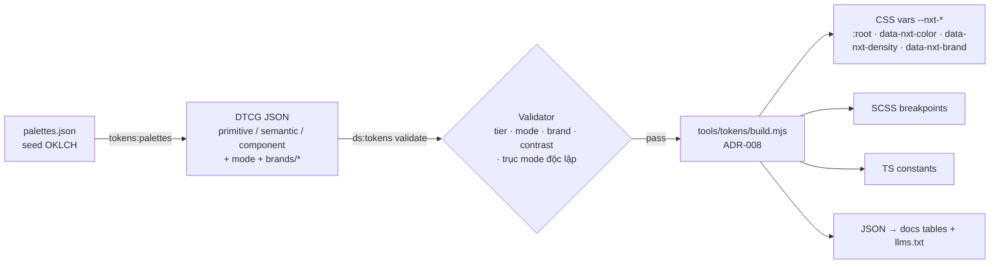
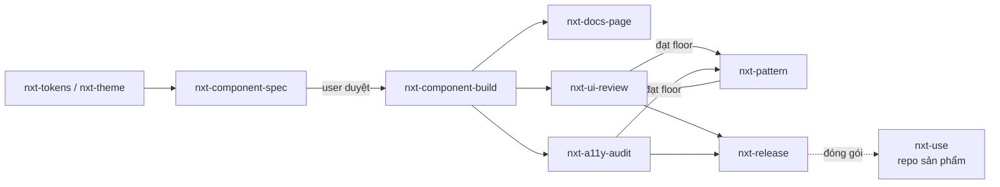

# Kế hoạch xây dựng NXT Design System

> **Phạm vi:** design system dùng chung cho nhiều sản phẩm phần mềm nghiệp vụ (HRM và các sản phẩm khác).
> **Stack:** Angular 21 standalone, Angular CDK/Aria headless, token W3C DTCG.
> **Tham chiếu:** [vnrpromax.vercel.app/styleguide](https://vnrpromax.vercel.app/styleguide/hrm/layout/grid) chỉ dùng để học hỏi. NXT không dùng lại code hay thương hiệu của trang này.
> Cập nhật: 2026-10-16

## Trạng thái (2026-10-19)

| Giai đoạn | Trạng thái | Đã có |
|-----------|-----------|-------|
| 0. Nền móng | ✅ Xong | Workspace Angular 21 (zoneless, Vitest, ng-packagr), npm 11; CI GitHub Actions; hook Claude Code; ADR 001–009; 10 skill + 1 agent |
| 1. Foundations & token | ✅ Xong | 589 token (11 thang OKLCH, semantic sáng/tối, 3 mật độ, 2 motion, typography, layout); nền sáng chỉnh lại để canvas xám tách khỏi surface trắng; brand mẫu `sample`; 430/430 lượt kiểm tương phản đạt; bộ icon Tabler chọn lọc 262 icon (ADR-003) |
| 2. Core components | 🟡 Đang làm | Beta, có SPEC + docs + axe: Button/IconButton, Stack/Inline/Grid, Menu (+ nhóm radio), Segmented, Form field, Checkbox, Tag/Badge, Avatar, Tooltip, Drawer, Tabs (tab tràn vào "Xem thêm"), Page header/Breadcrumb, Pagination, **Search** (tìm không dấu), **Filter** (Bộ lọc + chip + `NxtFilterState`). Còn lại xem Roadmap |
| 3. Dữ liệu & pattern | 🟡 Bắt đầu | Beta: App shell/Sidenav (rail, drawer mobile), Table (sắp xếp, chọn hàng, Shift chọn dải với `NxtSelection`, không bẻ dòng, `nxt-table-scroll` lấp đầy màn hình và cuộn trong lưới), Card/Stat (`fill`), **Descriptions** (nhãn – giá trị chỉ đọc), `nxtFill`, Progress, Timeline, Empty state. Pattern **Trang danh sách & danh mục** (bố cục chuẩn: Thêm mới, nhập/xuất Excel, tab trên toolbar, toolbar chỉ tìm kiếm + Bộ lọc). Mẫu màn hình HRM: Tổng quan, Danh mục (8 danh mục, nhập/xuất Excel, hoàn tác, lưới lấp đầy màn hình, drawer xem chi tiết có bản ghi trước/sau), Phê duyệt (lấp đầy khi màn rộng), **Quy trình duyệt** (danh sách + trình sửa bước, mô phỏng, phiên bản, cảnh báo rời trang), Đăng nhập |
| 4 | ⏳ Chưa bắt đầu | |

**Kiểm chứng ở thời điểm ghi:**
- `npm run ds:check` sạch (589 token, 430/430 tương phản, 0 giá trị hard-code);
- `npm test` 98/98 (17 file spec);
- `npm run test:a11y` 388/388 (axe trên 94 example × sáng/tối/gọn, 43 trang × sáng/tối, 20 test bàn phím và hành vi, gồm các luồng Danh mục: bộ lọc + chip, Shift chọn dải, xoá có hoàn tác, nhập CSV, xuất file, tab "Xem thêm", lưới lấp đầy màn hình, drawer chi tiết; Phê duyệt lấp đầy; Quy trình duyệt: kiểm lỗi khi Áp dụng, tăng phiên bản, cảnh báo rời trang);
- build `@nxt/ui` và docs không cảnh báo; bundle khởi tạo docs 593 kB (gần ngưỡng cảnh báo 600 kB, xem việc tiếp theo).

**Việc còn mở đã biết:** mỗi `packages/ui/<entry>/SPEC.md` có mục §11 "Việc còn mở" (ví dụ: CSS component còn dùng thẳng primitive `--nxt-space-*`, chuỗi giao diện chưa cho override, progress chưa có trạng thái indeterminate).

**Việc tiếp theo** (theo thứ tự):
1. Chốt các ADR còn "Đề xuất": 002, 004, 006, 007; xác nhận ADR-003 (Tabler).
2. Dọn §11 của các SPEC: thay primitive bằng semantic/component token, mở rộng detector để bắt lỗi này.
3. Đợt còn lại: Link, Spinner, Skeleton, Radio, Switch, NumberInput (VND), Combobox, DatePicker, Dialog/Confirm, Toast/Alert.
4. Nạp lazy chỉ mục tìm kiếm của docs (metadata + mục lục mọi trang đang ở bundle khởi tạo, 593/600 kB).
5. Visual regression.

## Mục lục
1. Trang tham chiếu đang có gì và NXT làm khác ở đâu
2. "UX tốt hơn" nghĩa là gì: mục tiêu đo được
3. Kiến trúc
4. Kiến trúc thông tin của docs site
5. Layout & Grid
6. Lộ trình theo giai đoạn
7. Bộ skill agent cho repo
8. Quyết định cần chốt (ADR)
9. Rủi ro

---

## 1. Trang tham chiếu đang có gì và NXT làm khác ở đâu

Phân tích dựa trên HTML, CSS và JS bundle của trang (ngày 2026-10-16), không phải test usability với người dùng. Các con số dưới đây là số đo trực tiếp từ bundle.

| Hạng mục | Trang tham chiếu | Vấn đề | NXT làm khác |
|----------|------------------|--------|--------------|
| Nền tảng | Angular, bọc **ng-zorro (Ant Design)** + Tailwind | Phải override CSS của Ant, khó làm UX sâu và kiểm soát a11y | Tự dựng component trên Angular CDK/Aria; token là gốc |
| Token | **2.321** CSS custom property; **731** khai báo `--ant-*` để ép Ant theo token; **413** `--tw-*` | Bề mặt API quá lớn, nhiều lớp phiên dịch | 3 tầng primitive → semantic → component, mục tiêu khoảng 700 token, mỗi token có `$description` |
| Kích thước CSS | Một file `styles.css` **1,08 MB** (chưa nén) cho mọi trang | Tải chậm, khó tách | CSS token chung + CSS theo từng component (secondary entry point) |
| Dark mode | Nhân đôi token component theo hậu tố `-light` / `-dark` (vd. `badge-error-bg-light/dark`) + class `.dark` | Số token component tăng gấp đôi, dễ lệch | Mode chỉ đổi ở tầng semantic; component token có **một** bản |
| Scale | `--space-scale` (.75/1/1.25), `--font-scale`, `--radius-scale`, `--duration-scale` | Ý tưởng tốt | **Giữ ý tưởng**, chuẩn hoá thành mode `density` và `motion` có kiểm tra tự động |
| Breakpoint | Trộn Ant (576/768/992/1200/1600), Tailwind (40–96rem) và ad-hoc (767/900/991) | Hành vi responsive không nhất quán | Một thang duy nhất + container query trong component |
| Grid | Lưới Ant 24 cột flex, gutter 8/16/24/32 | Phù hợp nhưng thiếu layout primitive cấp cao | Lưới 12 cột + primitive `stack` / `inline` / `grid` / `page` (xem §5) |
| Điều hướng docs | 9 nhóm, khoảng 150 route. Một mục xuất hiện ở nhiều nhóm (Affix; Command Palette; Popover / Tooltip / Popconfirm; Org Chart ở 3 nơi; Segmented; Watermark). 8 mục "missing" vẫn hiện trên menu (Masonry, Splitter, Tree, Tour, QRCode…) | Người dùng không biết mục nào là chuẩn; gặp trang chưa có | Mỗi mục xuất hiện một lần, có badge trạng thái (draft/beta/stable); mục dự kiến làm đặt ở trang Roadmap |
| Theme | Hơn 15 theme màu, 4 font, nhiều kiểu bề mặt (Kính mờ, Phẳng, Nổi nhẹ, Nhuộm màu…) | Tổ hợp tự do không đảm bảo tương phản; phá nhất quán giữa các sản phẩm | Brand slot giới hạn cho mỗi sản phẩm + light/dark + density; tương phản được kiểm tự động ở mọi tổ hợp |
| Ngôn ngữ | Nhãn trộn Việt/Anh ("Danh sách CRUD", "Button", "Nền trắng") | Thiếu nhất quán | Tiếng Việt là chính, thuật ngữ kỹ thuật giữ tiếng Anh có chủ đích; có glossary |

**Những điểm NXT học lại:**
- Token 3 tầng.
- Các ý tưởng scale cho density và motion.
- Cấu trúc trang docs: overview, "khi nào dùng", ví dụ, token.
- Nhóm component chuyên cho HRM: table cells, filter panel, workflow actions, org chart, setup guide.
- Template theo màn hình nghiệp vụ.

## 2. "UX tốt hơn" nghĩa là gì: mục tiêu đo được

Nguyên tắc chi tiết nằm ở [design/principles.md](design/principles.md). Dưới đây là các chỉ tiêu dùng để chấp nhận từng giai đoạn. Đây là **mục tiêu**, chưa phải số đo.

| Chiều | Chỉ tiêu |
|-------|----------|
| Accessibility | 100% component stable: 0 vi phạm axe (WCAG 2.2 AA) ở light/dark × 3 density; keyboard map có test 100% |
| Tương phản | 100% `contrastPairs` đạt ở mọi mode × brand (CI chặn) |
| Nhất quán | 0 literal màu trong `packages/` và trong repo sản phẩm (detector trong CI) |
| Hiệu năng | CSS token ≤ 25 KB gzip; mỗi component chỉ tải CSS của chính nó; docs Lighthouse Performance ≥ 95 |
| Năng suất người dùng | Mọi luồng trong catalog pattern làm được chỉ bằng bàn phím; mọi pattern có đủ trạng thái loading/empty/error/no-permission |
| Tiếng Việt | Tìm kiếm không dấu, sort theo `vi`, format `vi-VN` có sẵn trong component; font không cắt dấu chồng |
| Docs | Mỗi component có "Khi nào dùng / Khi nào không"; tìm được bằng `Ctrl+K` |
| Áp dụng | Đo % màn hình của sản phẩm dùng `@nxt/ui`; thời gian dựng một list page chuẩn |

## 3. Kiến trúc

### 3.1 Monorepo
```
nxt-design/
├─ packages/
│  ├─ tokens/        @nxt/tokens    DTCG JSON → Style Dictionary → CSS/SCSS/TS/JSON
│  ├─ icons/         @nxt/icons     SVG (đề xuất Lucide, ISC) → Angular component + sprite
│  ├─ ui/            @nxt/ui        component, mỗi component là một secondary entry point @nxt/ui/<name>
│  └─ patterns/      @nxt/patterns  khối ghép: list page, filter panel, app shell…
├─ apps/
│  └─ docs/          Docs site Angular (SSG) + examples (cũng là fixture test a11y/visual)
├─ tools/            Script dùng chung cho skill và CI (đã có)
├─ docs/             Kế hoạch, ADR, nguyên tắc thiết kế (đã có)
└─ .claude/          Skill + agent cho AI (đã có)
```
- **Angular CLI multi-project + một `package.json` gốc + npm 11** (`ng-packagr` cho thư viện). Kế hoạch ban đầu là pnpm; đã đổi vì npm 10.8 lỗi và pnpm chưa có sẵn, xem [ADR-009](adr/009-workspace.md). Chưa cần Nx; xem lại khi có từ 6 gói trở lên hoặc khi CI chậm.
- **Node ≥ 20.19.** Angular 21 yêu cầu `^20.19 || ^22.12 || ^24`.

### 3.2 Pipeline token

Luật chi tiết nằm ở [design/token-architecture.md](design/token-architecture.md).

### 3.3 Component
- **Angular 21:** standalone, `input()` / `model()` / `output()`, `OnPush`, chạy được ở chế độ zoneless. Test bằng Vitest, là test runner mặc định của Angular 21.
- **Headless:**
  - `@angular/cdk` cho overlay, a11y, dialog, listbox, menu, table, scrolling và drag-drop.
  - `@angular/aria` cho các pattern APG (combobox, grid, tabs, tree…). Gói này đang ở developer preview, nên xét theo từng component (ADR-004).
- **Style:**
  - `ViewEncapsulation.None`, các rule bọc trong `@layer nxt.components`, chỉ dùng `var(--nxt-*)`.
  - Variant và state phản ánh qua `data-*` / `aria-*`.
  - Sản phẩm tuỳ biến bằng cách override component token, không cần `::ng-deep`.
- Quy ước đầy đủ nằm ở [design/component-conventions.md](design/component-conventions.md).

### 3.4 Chất lượng & CI (GitHub Actions)
| Bước | Lệnh | Chặn merge |
|------|------|-----------|
| Token | `npm run ds:tokens` | ✓ |
| Hard-code | `npm run ds:hardcoded` | ✓ (error) |
| Lint + type | `ng lint`, `tsc` | ✓ |
| Unit | `ng test` (Vitest) | ✓ |
| A11y | Playwright + axe trên mọi example | ✓ |
| Visual | Playwright `toHaveScreenshot`, ma trận theme × mode × density | ✓ (diff phải được duyệt) |
| Docs | build + deploy preview mỗi PR | — |
| Release | Changesets → npm (registry nội bộ hoặc công khai: ADR-006) | — |

## 4. Kiến trúc thông tin của docs site

| Khu | Nội dung | Ghi chú |
|-----|----------|---------|
| **Bắt đầu** | Cài đặt · Theming cho sản phẩm · Dùng với AI agent (skill `nxt-use`, `llms.txt`) · Đóng góp | |
| **Nền tảng** | Màu · Typography · Spacing & Density · Layout & Grid · Elevation · Radius · Motion · Icon · Dark mode · Giọng văn & thuật ngữ | Bảng giá trị sinh từ token |
| **Components** | Nhóm theo **công việc**: Hành động · Nhập liệu · Lựa chọn · Hiển thị dữ liệu · Phản hồi · Overlay · Điều hướng · Bố cục | Mỗi mục xuất hiện **một** lần, có badge status |
| **Patterns** | List page · Lọc & tìm kiếm · Bulk action · Master-detail · Form · Phê duyệt · Dashboard · Import/Export · Trạng thái hệ thống · App shell | Đây là điểm khác biệt chính so với tham chiếu |
| **Templates** | Trang mẫu đầy đủ: hồ sơ nhân viên, danh sách, dashboard, login… | Ghép từ pattern |
| **Sản phẩm** | Mỗi sản phẩm một trang: brand slot, pattern riêng | Đa sản phẩm |
| **Tài nguyên** | Changelog · Roadmap & trạng thái · Tải token · Figma (nếu dùng) | |

Mọi ví dụ trên docs đều có thanh chuyển **brand / light-dark / density** ngay trên ví dụ, kèm nút copy code, link mở SPEC và bảng phím. Command palette `Ctrl+K` tìm được cả component, token và pattern.

## 5. Layout & Grid

- **Breakpoint:** `sm` 640 · `md` 768 · `lg` 1024 · `xl` 1280 · `2xl` 1536. Một thang duy nhất, sinh ra mixin SCSS và hằng số TS.
- **Lưới trang 12 cột.**
  - Gutter: 16 (< md) / 24 (md–lg) / 32 (≥ xl).
  - Margin trang: 16 / 24 / 32.
  - Container tối đa 1440px; bảng dữ liệu được dùng full-width.
- **Độ rộng nội dung theo loại trang:** full (bảng), 1280 (chi tiết/form 2 cột), 720 (form 1 cột, nội dung đọc).
- **Layout primitive** trong `@nxt/ui/layout`:
  - `nxt-stack`: dọc, gap là token.
  - `nxt-inline`: ngang, có wrap.
  - `nxt-grid`: 12 cột, hoặc `auto-fit` theo `min` (token).
  - `nxt-split`: sidebar + nội dung, splitter kéo được.
  - `nxt-page`: header, toolbar, content và footer action sticky.
- **Form layout:** label đặt trên; chuyển 1 → 2 cột bằng **container query**, không theo viewport, nên form trong drawer vẫn đúng.
- **Density:**
  - Control height: compact 28 / comfortable 32 / spacious 40.
  - Row height của bảng: 32 / 40 / 48.
  - Font tối thiểu 12px ở mọi density.
- **App shell:** sidebar 256 / 72 (thu gọn), header 56; tôn trọng `scroll-padding-top` để sticky header không che focus (WCAG 2.4.11).

## 6. Lộ trình theo giai đoạn

Thời lượng ước tính cho team 2 frontend + 1 designer bán thời gian. Mỗi giai đoạn chỉ kết thúc khi đạt **tiêu chí ra**.

| Giai đoạn | Thời lượng (ước tính) | Sản phẩm bàn giao | Tiêu chí ra |
|-----------|----------------------|-------------------|-------------|
| **0. Nền móng** | 1–2 tuần | pnpm + Angular workspace (`packages/*`, `apps/docs`); CI bảng §3.4 (mức tối thiểu); chốt ADR-001…006; **bộ skill + tools (đã xong ở lượt này)** | `ng build` / `ng test` / `ds:check` chạy trong CI; docs app trống deploy được |
| **1. Foundations & token** | 2–3 tuần | Primitive (neutral, brand mặc định, status, data viz) sinh bằng `ds:palette`; bộ semantic chuẩn ở light/dark; density × 3; motion × 2; typography scale; breakpoint; build Style Dictionary; `@nxt/icons`; trang docs Nền tảng; brand đầu tiên cho sản phẩm #1 | `ds:tokens` 0 error ở mọi tổ hợp; docs Foundations hoàn chỉnh; CSS token ≤ 25 KB gzip |
| **2. Core components** | 6–8 tuần | **A** Button, IconButton, Link, Icon, Badge/Tag, StatusTag, Avatar, Spinner, Skeleton, Divider, Tooltip · **B** FormField, Input, Textarea, NumberInput (VND), Select, Combobox, Checkbox, Radio, Switch, DatePicker, DateRangePicker · **C** Dialog, Confirm, Drawer, Popover, Menu, Toast, Alert · **D** Tabs, Breadcrumb, Pagination, Steps, layout primitives | Mỗi component đạt DoD (conventions §5) → status `beta`; mỗi đợt có review a11y |
| **3. Dữ liệu & pattern** | 5–7 tuần | `nxt-table` (sort, chọn, sticky, resize, virtual, tuỳ chọn cột, density) + table cells; EmptyState; DescriptionList; Timeline; Tree / TreeSelect; Upload; Filter panel & Quick filter; app shell, SideNav, TopBar, Command palette; pattern List page, Master-detail, Form, Phê duyệt | Pattern List page dựng được màn hình thật của sản phẩm #1, đạt quality floor; ≥ 5 component lên `stable` |
| **4. Mở rộng & áp dụng** | liên tục | Template; brand sản phẩm #2; schematic `ng add @nxt/ui`; skill `nxt-use` đóng gói cho repo sản phẩm; đồng bộ Figma (nếu dùng); đo áp dụng | Sản phẩm #2 áp dụng mà không cần token hay component riêng ngoài brand slot |

**Thứ tự này có chủ đích.** Token và a11y làm trước component, component làm trước pattern. Làm pattern trước rồi vá token sau là đúng con đường đã khiến trang tham chiếu phình tới 2.321 biến.

## 7. Bộ skill agent cho repo

Mô hình hoá từ các bộ skill thiết kế công khai trên GitHub (đã kiểm tra ngày 2026-10-16):

| Mẫu học từ | Repo | NXT áp dụng |
|-----------|------|-------------|
| Giải phẫu skill: `SKILL.md` ngắn + `references/` + `scripts/`, progressive disclosure, eval | [anthropics/skills](https://github.com/anthropics/skills) (`skill-creator`) | Mọi skill dưới 150 dòng, chi tiết đặt trong `references/` và `docs/design/` |
| Ngữ cảnh thiết kế lưu bền (PRODUCT.md / DESIGN.md), register "Operate", quality floor, detector chạy trong hook/CI | [pbakaus/impeccable](https://github.com/pbakaus/impeccable) | `docs/design/principles.md` (register + floor + anti-pattern), `check-hardcoded.mjs` |
| Design system lưu thành file master, dữ liệu dạng catalog, script tìm kiếm | [nextlevelbuilder/ui-ux-pro-max-skill](https://github.com/nextlevelbuilder/ui-ux-pro-max-skill) | Token DTCG là master; catalog pattern; script thay cho văn xuôi |
| Skill mỏng + bộ luật tách riêng, báo cáo `file:line` | [vercel-labs/agent-skills](https://github.com/vercel-labs/agent-skills) (`web-design-guidelines`) | Định dạng finding của `nxt-ui-review` / `nxt-a11y-audit`; luật **vendored**, không fetch online |
| "Critical rules" + rule file sâu, xuất docs dạng `.md` cho agent | [shadcn-ui/ui](https://github.com/shadcn-ui/ui/tree/main/skills/shadcn) | Luật cứng ở đầu mỗi skill; `llms.txt` + raw markdown trên docs |
| Kiến thức Angular chính thức | [angular/skills](https://github.com/angular/skills) (`angular-developer`) | Cài bổ sung, NXT không viết lại |
| DESIGN.md + lint / diff / export DTCG | [google-labs-code/design.md](https://github.com/google-labs-code/design.md) (alpha) | Theo dõi; có thể sinh DESIGN.md từ token cho công cụ bên ngoài |
| Agent `design-system-architect`, `accessibility-expert` | [wshobson/agents](https://github.com/wshobson/agents) (`ui-design`) | Agent `nxt-design-reviewer` review độc lập |

**Không học theo:**
- Bộ sinh style hoặc palette ngẫu nhiên.
- Các lệnh kiểu "bolder", "delight", "overdrive".
- Luật fetch online lúc chạy.
- Palette dành cho app tiêu dùng.

Những thứ này sai với phần mềm nghiệp vụ dữ liệu dày.

### 7.1 Danh mục (đã tạo trong `.claude/`)

| Skill | Khi nào dùng | Đầu ra | Công cụ |
|-------|-------------|--------|---------|
| `nxt-tokens` | Thêm/sửa/đổi tên/deprecate token | DTCG JSON + validator sạch | `ds:tokens`, `ds:contrast` |
| `nxt-theme` | Brand cho một sản phẩm | `src/brands/<product>/` + trang sản phẩm | `ds:palette`, `ds:tokens` |
| `nxt-component-spec` | Trước khi code component | `packages/ui/<name>/SPEC.md` | `ds:new`, APG reference |
| `nxt-component-build` | Implement theo SPEC | Component + token + test + example | `ds:new`, `ds:check`, `ng test` |
| `nxt-pattern` | Ghép luồng nghiệp vụ | `PATTERN.md` + example/pattern code | catalog 10 pattern |
| `nxt-docs-page` | Viết docs | Trang docs + dòng `llms.txt` | template docs |
| `nxt-ui-review` | Review / polish UI | Bảng finding P0–P3 có nguồn | `ds:hardcoded`, heuristics, agent reviewer |
| `nxt-a11y-audit` | Audit WCAG 2.2 AA | Báo cáo theo SC + checklist thủ công | `ds:tokens` (contrast), axe/Playwright |
| `nxt-release` | Phát hành | Changeset, changelog, migration, gate | Changesets, gate commands |
| `nxt-use` | Repo **sản phẩm** dùng NXT | Màn hình đúng chuẩn | component picker |
| Agent `nxt-design-reviewer` | Second opinion độc lập | Bảng finding | read-only |

### 7.2 Luồng làm việc


### 7.3 Tooling dùng chung (`tools/`, đã chạy thử)
| Lệnh | Script | Làm gì |
|------|--------|--------|
| `npm run tokens:build` | `tools/tokens/build.mjs` | Sinh CSS theo mode/brand (khai báo lại phụ thuộc cho mode lồng nhau), SCSS breakpoint, JS, JSON cho docs |
| `npm run tokens:palettes` | `tools/tokens/palette.mjs --config` | Sinh lại 11 thang màu core từ `packages/tokens/palettes.json` |
| `npm run docs:generate` | `tools/docs/generate.mjs` | Đổi markdown thành HTML theo segment, lập danh mục example, trích API từ source, sinh `llms.txt`; báo lỗi nếu tham chiếu tới example/API không tồn tại |
| (hook) | `tools/hooks/post-edit-check.mjs` | Sau mỗi Edit/Write của Claude Code: kiểm hard-code hoặc token của file vừa sửa; lỗi thì exit 2 |
| `npm run ds:tokens` | `tools/tokens/validate.mjs` | Kiểm tier, tên, `$type`, alias, vòng lặp, độ phủ mode, brand chỉ override, va chạm CSS var, `$description`, deprecated, **tương phản ở mọi mode × brand** |
| `npm run ds:palette -- --name x --seed "#hex"` | `tools/tokens/palette.mjs` | Sinh thang OKLCH 11 bước (gamut-map về sRGB) dạng DTCG, kèm bảng tương phản và gợi ý bước fill |
| `npm run ds:contrast -- fg bg` | `tools/tokens/contrast.mjs` | Tương phản WCAG cho một cặp màu (hỗ trợ alpha) |
| `npm run ds:hardcoded` | `tools/lint/check-hardcoded.mjs` | Bắt literal màu (error), px / z-index / font-family / `!important` / `::ng-deep` (warn); `file:line` |
| `npm run ds:new -- <name> [--attribute]` | `tools/scaffold/component.mjs` | Tạo SPEC, component, CSS, test, token, docs, example; không ghi đè file đã có |

Các script không cần dependency nào và chạy được trên Node 20.

### 7.4 Bước tiếp theo cho bộ skill
- ✅ **Hook** (`.claude/settings.json`): sau Edit/Write file `.css` / `.scss` / `.html` / `.ts` trong `packages/` hoặc `apps/`, hook chạy `check-hardcoded`; sửa file token thì chạy validator. Đã kiểm đầu-cuối: ghi `#ff0000` thì hook chặn và trả lỗi về cho agent.
- **Visual regression:** Playwright `toHaveScreenshot` trên example. Baseline phải chụp trên Linux (CI) để tránh lệch font giữa các hệ điều hành.
- **Eval cho skill:** dùng `skill-creator` để chạy so sánh có skill và không có skill, và tối ưu description cho đúng lúc kích hoạt.
- **Figma** (nếu team dùng): skill `nxt-figma-sync` qua Figma MCP (`get_variable_defs`), so sánh Figma Variables với token DTCG.
- **Đóng gói `nxt-use`** vào `@nxt/ui` để repo sản phẩm cài một lần là có skill.

## 8. Quyết định cần chốt (ADR)

Đã ghi tại [docs/adr/](adr/README.md). ADR 001, 005, 008, 009 đã áp dụng trong code và chờ xác nhận; 002, 003, 004, 006, 007 còn ở trạng thái đề xuất. Bảng dưới là đề xuất ban đầu.

| ADR | Câu hỏi | Đề xuất ban đầu |
|-----|---------|-----------------|
| 001 | Font mặc định | **Inter** (có tabular numbers, hỗ trợ tiếng Việt); kiểm dấu chồng ở 12–14px; sản phẩm được đổi qua brand slot |
| 002 | Lưới dữ liệu nâng cao (pivot, group, master-detail lớn) | `nxt-table` trên CDK cho khoảng 80% trường hợp + **adapter theme** cho một data grid chuyên dụng (vd. AG Grid Community) cho phần còn lại; không tự viết pivot |
| 003 | Bộ icon | **Lucide** (ISC), bọc thành `@nxt/icons`, có tree-shaking |
| 004 | Dùng `@angular/aria` (developer preview) hay chỉ CDK | Dùng cho combobox/tabs/tree/grid khi API đã ổn trong v21.x; bọc sau API NXT để đổi được về sau |
| 005 | Docs dùng app Angular tự dựng hay Storybook | **App Angular tự dựng** (UX tốt hơn, dùng chính component của NXT), example dùng làm fixture test; Storybook không bắt buộc |
| 006 | Scope npm và nơi publish | `@nxt/*` trên registry nội bộ (GitHub Packages / Verdaccio); kiểm tra quyền đặt tên scope |
| 007 | Có dùng Figma làm nguồn không | Token DTCG là nguồn sự thật; Figma chỉ đồng bộ một chiều từ token |

## 9. Rủi ro

| Rủi ro | Ảnh hưởng | Giảm thiểu |
|--------|-----------|------------|
| `@angular/aria` đổi API khi còn developer preview | Phải sửa component | Bọc sau API NXT; đã có phương án fallback về CDK |
| Data grid tự viết tốn quá nhiều công | Trễ Phase 3 | ADR-002: dùng adapter cho trường hợp nặng |
| Sản phẩm đòi "theme riêng" ngoài brand slot | Phá nhất quán | Validator chặn brand thêm token; quy trình đề xuất slot mới qua core |
| Token phình lại theo thời gian | Mất kiểm soát API | Review token trong mỗi PR (`nxt-tokens`); theo dõi số token mỗi release |
| Docs lệch với code | Người dùng làm sai | Bảng API/token sinh tự động; example là fixture test |
| Phụ thuộc AI agent tạo code kém chất lượng | Nợ kỹ thuật | Validator và detector chặn trong CI; review độc lập bằng agent + người |
